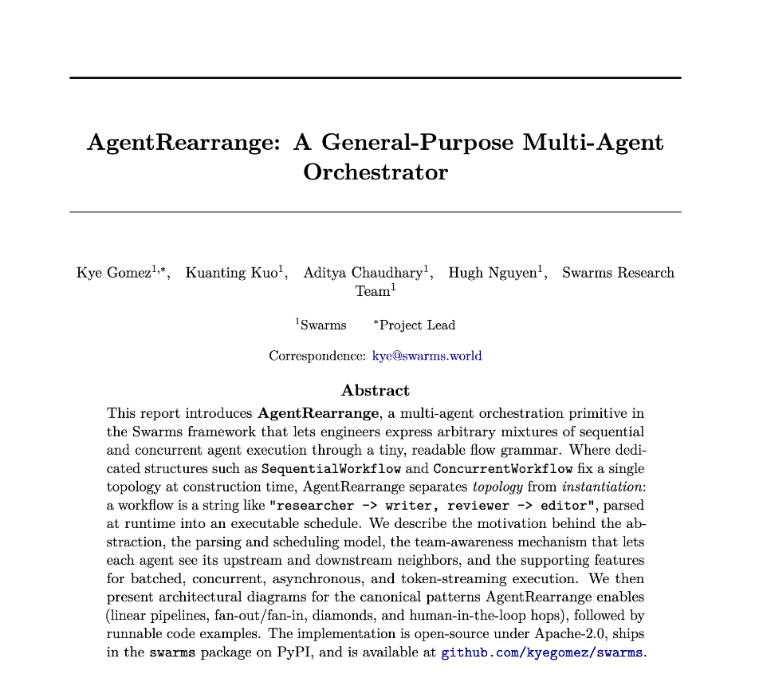

</img>

## AgentRearrange

Code, benchmarks and LaTeX source for <a href="./paper.pdf">AgentRearrange: Simplifying Multi-Agent Workflow Orchestration</a>.

`AgentRearrange` is the workflow primitive of <a href="https://github.com/kyegomez/swarms">Swarms</a>. A whole multi-agent workflow is one string: `->` runs steps in sequence and `,` runs the agents of a step in parallel.

```
Planner -> Tech, Market, Legal -> Writer
```

The paper gives the grammar and execution model, compares the code needed for the same workflow in LangGraph, AutoGen, LangChain, Agno and CrewAI, and benchmarks how each scales from 8 to 512 agents.

## Install

```bash
$ pip install -U swarms
```

## Usage

```python
from swarms import Agent, AgentRearrange

planner = Agent(agent_name="Planner", model_name="gpt-5.4", max_loops=1)
tech    = Agent(agent_name="Tech",    model_name="gpt-5.4", max_loops=1)
market  = Agent(agent_name="Market",  model_name="gpt-5.4", max_loops=1)
legal   = Agent(agent_name="Legal",   model_name="gpt-5.4", max_loops=1)
writer  = Agent(agent_name="Writer",  model_name="gpt-5.4", max_loops=1)

workflow = AgentRearrange(
    agents=[planner, tech, market, legal, writer],
    flow="Planner -> Tech, Market, Legal -> Writer",
)

report = workflow.run("Assess launching a payments product in the EU.")
```

Print the plan without calling a model

```python
workflow.explain()

# Flow: Planner -> Tech, Market, Legal -> Writer
#
# Step 1: Planner              [sequential]
# Step 2: Tech, Market, Legal  [parallel, 3 agents]
# Step 3: Writer               [sequential]
#
# 3 steps, 5 agent invocations across 1 loop(s).
```

Rearrange the same agents. The new flow is validated first, and the old one is kept if it fails.

```python
workflow.set_custom_flow("Planner -> Tech -> Market -> Legal -> Writer")
```

Nest a workflow as a single step of another

```python
experts = AgentRearrange(
    name="Experts",
    agents=[tech, market, legal],
    flow="Tech -> Market, Legal",
)

workflow = AgentRearrange(
    agents=[planner, experts, writer],
    flow="Planner -> Experts -> Writer",
)
```

More runnable scripts are in <a href="./examples">examples</a>.

## Flow language

```
flow  ::=  step ( "->" step )*
step  ::=  name ( "," name )*
```

| Flow | Shape |
|---|---|
| `a -> b -> c` | chain |
| `a, b, c` | fan-out |
| `a -> b, c -> d` | fan-out, fan-in |
| `a, b -> c, d -> e` | layered |
| `writer -> critic -> writer` | revisit |

## Benchmarks

Four workflow shapes at 8, 32, 128 and 512 agents, a 10 ms stubbed model, each cell in a fresh interpreter. No API key needed.

```bash
$ pip install swarms langgraph langchain-core autogen-agentchat autogen-ext agno crewai
$ python benchmarks/benchmark_agent_rearrange.py --out results.json
```

Orchestration overhead at 512 agents, in ms (Apple M3 Pro, Python 3.12, median of 3)

| | Chain | Fan-out | Diamond | Layered |
|---|---|---|---|---|
| AgentRearrange | 887 | **37** | 42 | 991 |
| LangGraph (functions) | **186** | 92 | 105 | 192 |
| LangGraph (agents) | 2,246 | 355 | 372 | 1,556 |
| LangChain LCEL | 901 | 117 | 121 | 231 |
| AutoGen GraphFlow | 6,432 | 5,970 | 6,174 | 6,486 |
| Agno Workflow | 558 | 40 | **35** | **100** |
| CrewAI Crew | 4,240 | - | 3,380 | - |

- Wide workflows are where it does well: 2.5x less overhead than LangGraph with function nodes, about 9x less than LangGraph with agent nodes.
- Deep workflows are where it does not: every agent reads the whole shared conversation, so long chains cost more than in frameworks that do constant work per step.
- Changing topology with `set_custom_flow` is 9x to about 100x faster than rebuilding a LangGraph graph.

The raw numbers behind every figure and table in the paper are in <a href="./benchmarks/results/scaling_2026-11-13.json">benchmarks/results/scaling_2026-11-13.json</a>. The numbered scripts in <a href="./benchmarks">benchmarks</a> are earlier experiments and are not reported in the paper.

## Paper

- <a href="./paper.pdf">paper.pdf</a>
- <a href="./paper.tex">paper.tex</a>, a single self-contained file

```bash
$ tectonic paper.tex
```

## Todo

- [ ] run parallel steps on one event loop instead of one thread per agent
- [ ] give agents a bounded view of the conversation, to break the quadratic growth of context in long chains
- [ ] parentheses for inline nesting, so any series-parallel workflow is a single string
- [ ] look agent names up in a dictionary when validating a flow

## Citations

```bibtex
@misc{gomez2026agentrearrange,
    title   = {AgentRearrange: Simplifying Multi-Agent Workflow Orchestration},
    author  = {Kye Gomez and {Steve-Dusty} and Adi Chaudhary and Ayaan Gazali and Shryuk Grandhi and Wyatt Stanke and {Taddy} and Vidith Salla and NingLin Liu and Nicolas Nahas},
    year    = {2026},
    month   = {November},
    url     = {https://github.com/The-Swarm-Corporation/AgentRearrange-Paper}
}
```

```bibtex
@software{gomez2023swarms,
    title   = {Swarms: The Enterprise-Grade Production-Ready Multi-Agent Orchestration Framework},
    author  = {Kye Gomez and contributors},
    year    = {2023},
    url     = {https://github.com/kyegomez/swarms}
}
```

```bibtex
@inproceedings{rogozhnikov2022einops,
    title     = {Einops: Clear and Reliable Tensor Manipulations with Einstein-like Notation},
    author    = {Alex Rogozhnikov},
    booktitle = {International Conference on Learning Representations},
    year      = {2022}
}
```

```bibtex
@article{valdes1982recognition,
    title   = {The Recognition of Series Parallel Digraphs},
    author  = {Jacobo Valdes and Robert E. Tarjan and Eugene L. Lawler},
    journal = {SIAM Journal on Computing},
    volume  = {11},
    number  = {2},
    pages   = {298--313},
    year    = {1982}
}
```

```bibtex
@article{wang2024mixture,
    title   = {Mixture-of-Agents Enhances Large Language Model Capabilities},
    author  = {Junlin Wang and Jue Wang and Ben Athiwaratkun and Ce Zhang and James Zou},
    journal = {arXiv preprint arXiv:2406.04692},
    year    = {2024}
}
```

```bibtex
@article{wu2023autogen,
    title   = {AutoGen: Enabling Next-Gen LLM Applications via Multi-Agent Conversation},
    author  = {Qingyun Wu and Gagan Bansal and Jieyu Zhang and Yiran Wu and Beibin Li and Erkang Zhu and Li Jiang and Xiaoyun Zhang and Shaokun Zhang and Jiale Liu and Ahmed Hassan Awadallah and Ryen W. White and Doug Burger and Chi Wang},
    journal = {arXiv preprint arXiv:2308.08155},
    year    = {2023}
}
```
